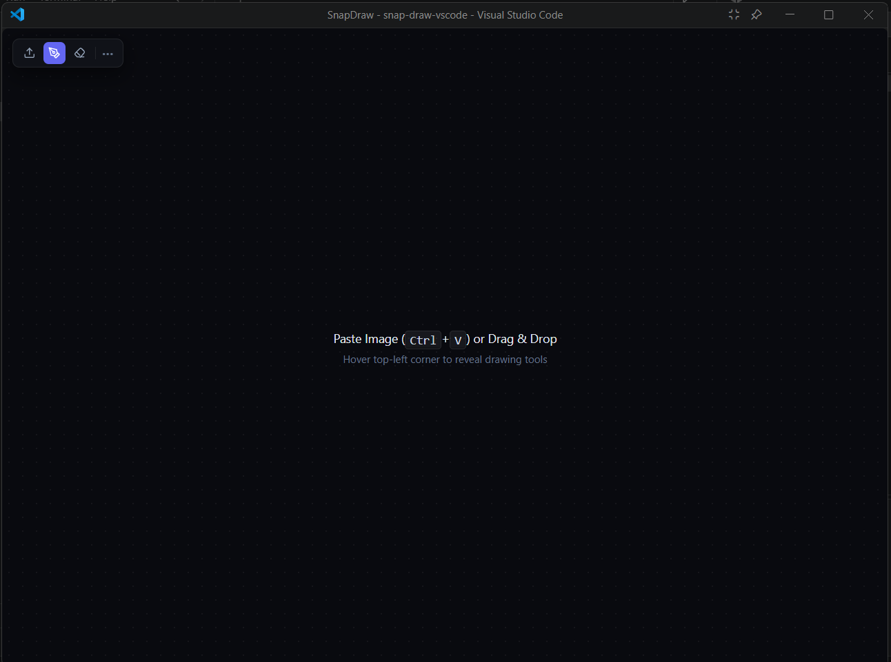
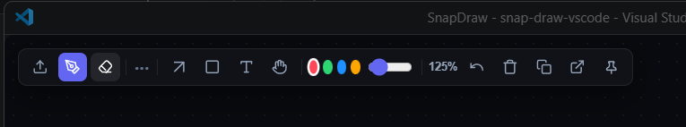
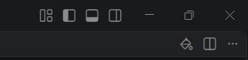

<div align="center">


# SnapDraw

### Paste a screenshot. Annotate it. Copy it back. Never leave VS Code.


**Created by [Subham Kumar Gupta](https://github.com/SubhamKumarg)**

</div>

---

## 📖 Overview

**SnapDraw** is a lightweight, high-performance VS Code extension that opens a sleek floating canvas over your editor. Paste a screenshot, mark it up with arrows, boxes, text and freehand drawing, then copy the annotated image back to your clipboard, ready for a bug report, pull request or chat.

Built with **vanilla JavaScript**, the native **HTML5 Canvas** and the **VS Code Webview API**:

- ⚡ **~4 KB** total size
- 📦 **Zero `node_modules`**, zero runtime dependencies
- 🛠️ **No build step**: edit a file, press `F5`, see the result

---

## 🖼️ Preview

**The floating canvas** (drop zone, with the drawing drawer auto-hidden in the top-left corner):

<p align="center">
  
</p>

**The full toolbar** (hover the top-left corner to reveal it):

<p align="center">
  
</p>

**Launch button in the editor title bar:**

<p align="center">
  
</p>

---

## ✨ Features

| Feature | Description |
|---|---|
| 📋 **Instant Paste** | Press `Ctrl+V` (`Cmd+V` on macOS) to paste a screenshot |
| 🖱️ **Drag & Drop** | Drop an image file onto the canvas |
| ⬆️ **Upload** | Pick an image from disk with the upload button |
| ✏️ **Freehand Pen** | Smooth freehand drawing |
| ➡️ **Arrows** | Point at exactly what matters |
| ▭ **Rectangles** | Highlight regions |
| 🔤 **Inline Text** | Type labels directly on the image |
| 🧽 **Eraser** | Remove annotations |
| ✋ **Pan & 🔍 Zoom** | Mouse wheel to zoom, `Space` + drag (or the hand tool) to pan; live zoom % display |
| 🎨 **Colors & Brush Size** | Quick color swatches and a size slider |
| ↩️ **Undo / 🗑️ Clear** | Fix mistakes or start fresh |
| 📎 **Copy to Clipboard** | Copy the finished, annotated image in one click |
| 📌 **Always-On-Top** | Pin the floating window above your editor |
| 🎛️ **Auto-Hiding Drawer** | Minimal UI that stays out of your way |

---

## 🚀 Quick Start (Install & Test in 5 Minutes)

**You need:** [VS Code](https://code.visualstudio.com/) 1.70+ and [Git](https://git-scm.com/downloads). No `npm install` required: SnapDraw has no dependencies.

### Option A: Run it instantly (best for trying it out or developing)

1. **Clone the repo**
   ```bash
   git clone https://github.com/SubhamKumarg/snap-draw-vscode.git
   cd snap-draw-vscode
   ```
2. **Open the folder in VS Code**
   ```bash
   code .
   ```
3. **Press `F5`** (or **Run → Start Debugging**). A second window titled **[Extension Development Host]** opens with SnapDraw loaded.
4. **Open SnapDraw** in that new window: click the SnapDraw icon in the editor title bar, or press `Ctrl+Shift+P` and type **SnapDraw**.
5. **Use it:** take a screenshot (`Win+Shift+S` on Windows, `Cmd+Shift+4` on macOS), click the SnapDraw window, press `Ctrl+V`, annotate, then click the **copy** button.

> 💡 After changing code, press `Ctrl+Shift+F5` to restart the Extension Development Host.

### Option B: Install permanently as a `.vsix`

```bash
npx @vscode/vsce package
code --install-extension snap-draw-canvas-0.0.1.vsix
```

Or in VS Code: **Extensions** panel → **`···`** menu → **Install from VSIX…** → pick the file → reload.

### ❓ Troubleshooting

| Problem | Fix |
|---|---|
| `F5` does nothing | Open the **root folder** (the one containing `package.json`) |
| `Ctrl+V` doesn't paste | Click inside the SnapDraw canvas first so it has focus |
| Command not found | Use the **Extension Development Host** window, not your original window |
| `vsce` complains about repository/license | Add a `repository` field to `package.json` and keep the `LICENSE` file |

---

## 🗂️ Project Structure

> ⚠️ Update this tree to match your real files.

```text
snap-draw-vscode/
├── .vscode/launch.json   # Enables F5 run
├── extension.js          # Entry point: registers command, creates webview
├── media/                # Webview assets (canvas logic, styles, icons)
├── images/               # README screenshots (+ icon.png for the Marketplace)
├── package.json          # Extension manifest
├── LICENSE
└── README.md
```

---

## 🤝 Contributing

All contributions are welcome: typo fixes, bug fixes, or whole new tools. With no build step and no dependencies, you can be productive in minutes.

1. **Fork** this repo (button at the top right of GitHub).
2. **Clone your fork** and `cd` into it.
3. **Create a branch:** `git checkout -b feature/my-feature`
4. **Code and test:** press `F5` and try your change live.
5. **Commit:** `git commit -am "feat: add circle tool"`
6. **Push:** `git push origin feature/my-feature`
7. **Open a Pull Request** on GitHub describing *what* and *why* (screenshots/GIFs are great).

### 🧩 Adding a new drawing tool

1. Add a toolbar button (SVG icon) in the webview HTML.
2. Register the tool name where the current tool is tracked (e.g. `currentTool = 'circle'`).
3. Add a branch for it in the canvas `mousedown` / `mousemove` / `mouseup` handlers.
4. Make sure it is included when the canvas re-renders, so zoom, pan, undo and eraser keep working.
5. Press `F5` and test paste → draw → erase → copy.

### 📝 Guidelines

- **No dependencies.** Zero `node_modules` is a core feature.
- Vanilla JavaScript and native browser APIs only.
- One feature or fix per pull request.
- Match the existing code style; use prefixes like `feat:`, `fix:`, `docs:`.
- Mention your OS (Windows / macOS / Linux) in the PR.

**Found a bug or have an idea?** Open an [Issue](https://github.com/SubhamKumarg/snap-draw-vscode/issues) with steps to reproduce, your OS and your VS Code version.

**Good first ideas:** circle tool · highlighter · redo (`Ctrl+Y`) · save image to file · custom color picker · keyboard shortcuts per tool.

---

## 🌍 Publishing to the VS Code Marketplace (maintainers)

1. Make sure `package.json` has: `name`, `displayName`, `version`, `publisher`, `engines.vscode`, `repository`, `license`, `icon` (a 128×128 PNG, e.g. `images/icon.png`).
2. Create a publisher at <https://marketplace.visualstudio.com/manage> and a Personal Access Token (Azure DevOps → *User settings → Personal access tokens* → scope **Marketplace → Manage**, organization **All accessible organizations**).
3. Log in and publish:
   ```bash
   npx @vscode/vsce login YOUR-PUBLISHER-ID
   npx @vscode/vsce publish
   ```
4. Optional: also publish to [Open VSX](https://open-vsx.org/) (used by VSCodium and others) with `npx ovsx publish -p <token>`.

---

## 🗺️ Roadmap

- [ ] Redo support
- [ ] Circle / line / highlighter tools
- [ ] Export to PNG file
- [ ] Publish to the VS Code Marketplace

---

## 📄 License

Released under the [MIT License](LICENSE).

## 👤 Author

**Subham Kumar Gupta** · [@SubhamKumarg](https://github.com/SubhamKumarg)

If SnapDraw saves you time, please give it a ⭐. It helps others find it!

<div align="center">

Made with ❤️ by **Subham Kumar Gupta**

</div>
